### yo, I'm Urban, people call me bunny, my online presence is `pseudobun`

MSc in CS from [FERI](https://feri.um.si/en/). into web3, decentralization and making things fast.

#### work

- [LutraID](https://id.lutralabs.io): issue and verify EUDI Wallet credentials
- [Masca](https://masca.io): decentralized identity wallet as a MetaMask Snap

#### macOS tools

  

#### contact

[urban@bunnys.cloud](mailto:urban@bunnys.cloud) ([PGP](https://raw.githubusercontent.com/pseudobun/dotfiles/main/bunnys-cloud-pgp-key.asc)) · [urbanfoundit@gmail.com](mailto:urbanfoundit@gmail.com) ([PGP](https://raw.githubusercontent.com/pseudobun/dotfiles/main/urbanfoundit-pgp-key.asc))

off-screen: bouldering, skiing, film buff, hiphop head and dog person 🐶

